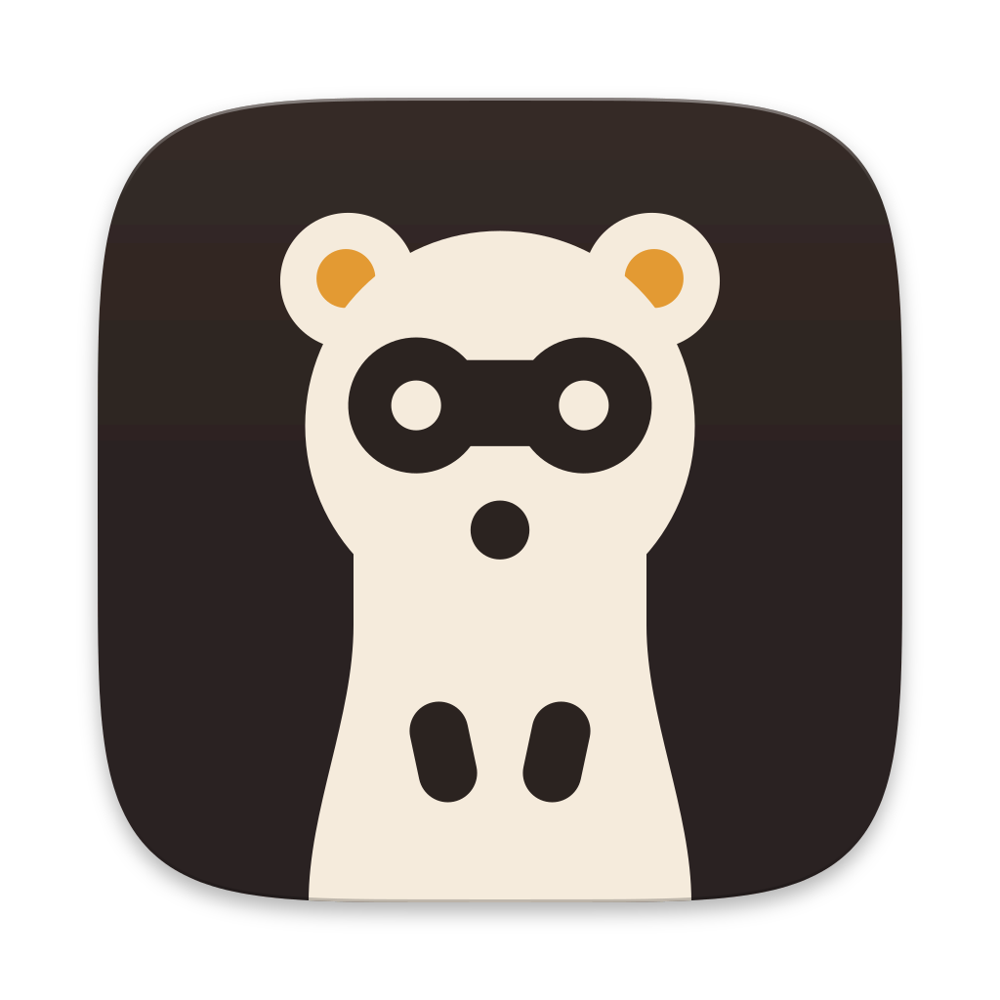
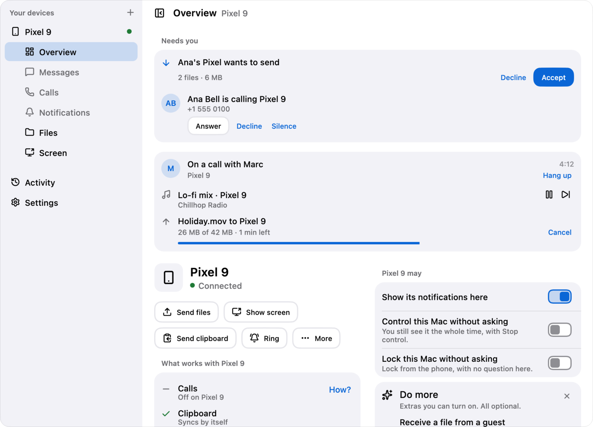
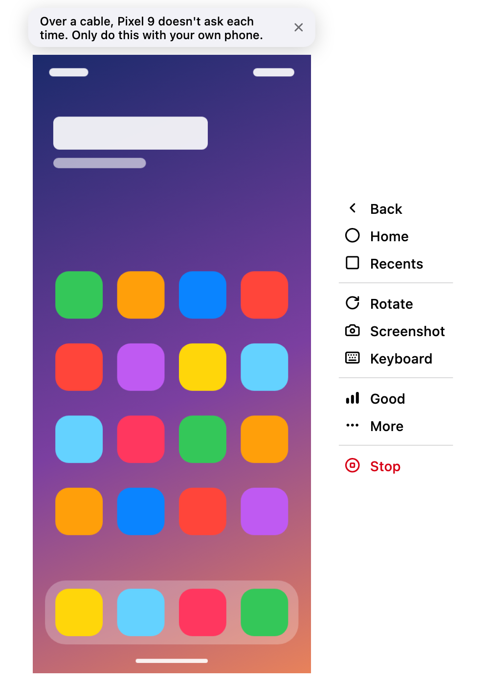
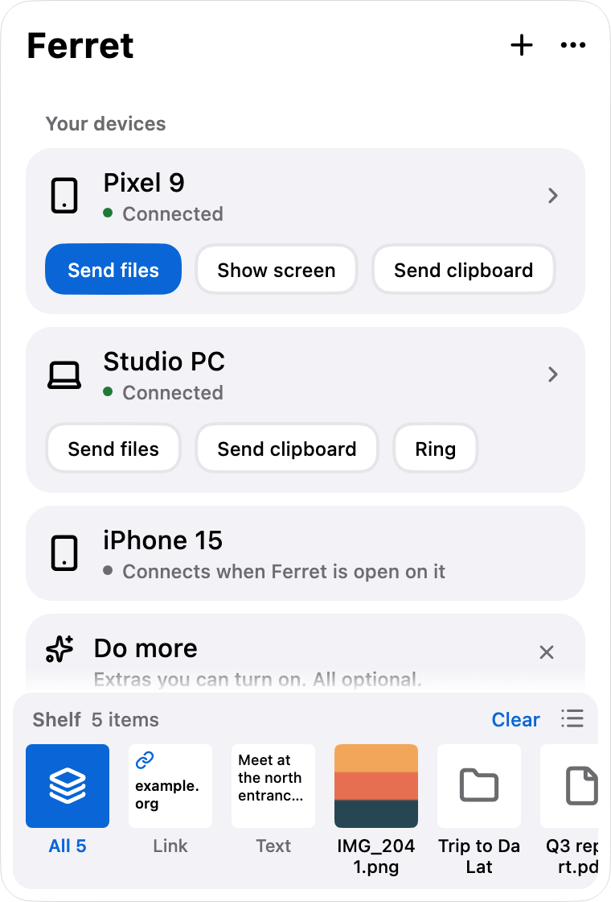
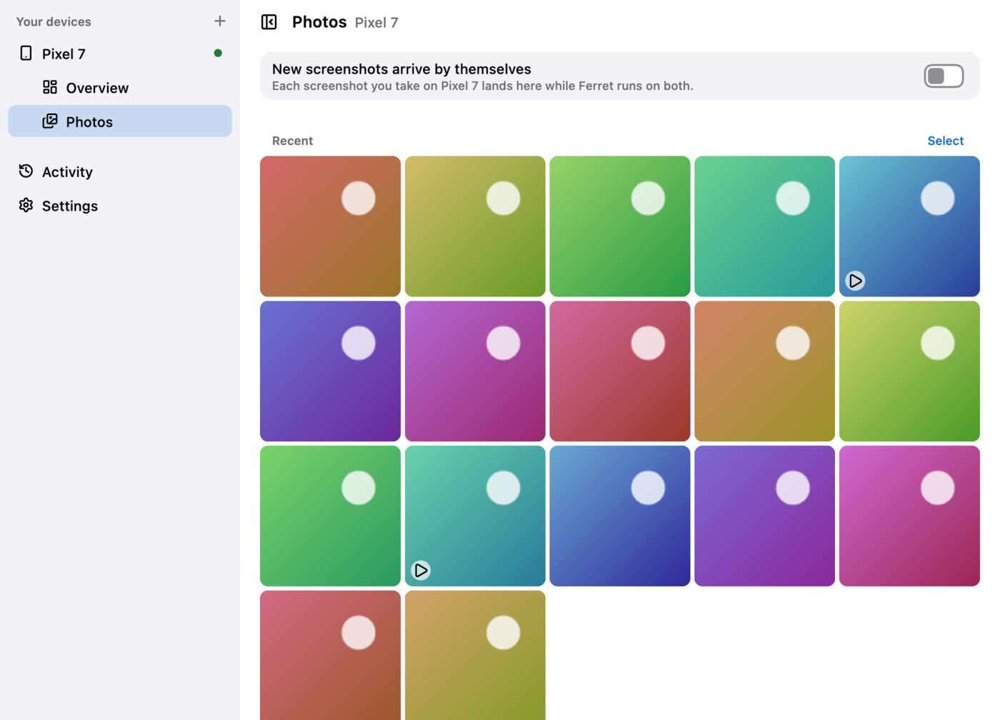

<p align="center">
  <picture>
    <source media="(prefers-color-scheme: dark)" srcset="branding/ferret-icon-dark.svg">
    
  </picture>
</p>

<h1 align="center">Ferret</h1>

<p align="center">
  <b>Your phone and your computers, working as one. On your Wi-Fi, with no account.</b>
</p>

<p align="center">
  <b>F.E.R.R.E.T.</b> · <b>F</b>ast <b>E</b>ncrypted <b>R</b>elay for <b>R</b>esuming <b>E</b>very <b>T</b>ask
</p>

<p align="center">
  <a href="LICENSE"></a>
  <a href="https://github.com/sponsors/simonpham"></a>
</p>

Hi folks 👋

You copy something on your phone and need it on your laptop. A file sits on the wrong device. Your phone rings in the other room. Every fix out there wants an account, a cloud, or a phone from one brand.

**Ferret** connects your own devices straight to each other, on the Wi-Fi you're already on. Android, iPhone, Mac, Windows and Linux, in any mix.

- 🔒 **Local network only.** Your devices talk directly, end-to-end encrypted with Noise.
- 🙅 **No account. No cloud. No telemetry.** Nothing to sign up for, nothing phoning home.
- 🔓 **Open source.** GPL-3.0 apps and an MIT protocol, so anyone can build a compatible client.

<p align="center">
  <picture>
    <source media="(prefers-color-scheme: dark)" srcset="docs/assets/readme/window-overview-dark.png">
    
  </picture>
</p>

> 🧪 **Status: before the first release.** Ferret is built and tested on macOS and Android first. The Windows, Linux and iPhone apps are written and run in tests, but have met fewer real machines. Things marked *beta* below mean it.

## ✨ What you can do

### 📋 Clipboard

- Copy on one device, paste on another. Text, links and images.
- Password-manager items stay put.
- **Recent clips**: the last 20 things you copied, anywhere, one click to copy again.

### 📦 Files and folders

- Drop files on a device and they're there. Progress, checked with SHA-256, resumes after a dropped connection, never overwrites.
- Send a whole folder and it arrives as a folder.
- **Share → Ferret** on Mac and iPhone, **Send with Ferret** in the Windows and Linux file managers, and `ferret-cli send`.
- Works with **LocalSend**, and Android phones can send with **Quick Share** with nothing installed.

### 🔔 Notifications, texts and calls (from Android)

- Your phone's notifications on your computer, with **Reply** and **Dismiss** synced both ways.
- Read and reply to your texts from the computer.
- See who's calling, then answer, decline or silence. Your music pauses while you talk.
- One-time codes stay on the phone as **Code hidden** unless you say otherwise.

### 🔄 Continue where you left off

- Send a page or link to another device with **Continue on…**, or from the browser extension (Chrome, Edge, Brave, Firefox).
- See what plays on your other devices, control it, and **Continue here** at the same second.

### 🪞 Your phone's screen on your computer

- **Show screen** puts an Android phone's screen on your computer, over Wi-Fi with Ferret on the phone. On a Mac it gets its own phone-shaped window.
- 🔊 Its sound comes along too.
- 🖱️ Over a cable, click, scroll and type on it. No Ferret needed on the phone. *Beta*, powered by scrcpy's server.
- 📲 iPhone and iPad through AirPlay. *Beta*.
- 📸 Screenshot at full size with one click.

<p align="center">
  <picture>
    <source media="(prefers-color-scheme: dark)" srcset="docs/assets/readme/screen-mirroring-dark.png">
    
  </picture>
</p>

### 🖼️ Photos and the camera

- Browse your phone's recent photos and screenshots from the computer, and save the ones you want.
- New screenshots can land on the computer by themselves.
- **Take a photo**: press a key on the computer, shoot on the phone, and it's on your clipboard.

### 🔍 Find, wake and control

- **Ring** a lost phone or computer, even on silent.
- **Wake** a sleeping computer with Wake-on-LAN.
- Use your phone as a **touchpad and keyboard**, or as a **presentation clicker**.
- **Sleep, restart, shut down, lock** or run your own commands on a computer from your phone. The computer asks first, once.
- **Lock when your phone leaves**: walk away with an Android phone and your computer locks itself.
- 🔋 See every device's battery, and hear about it once when it's low.

### 🤖 Scripting

- `ferret-cli watch --json` streams what happens (connected, battery, files, calls) to your own scripts.
- Drop an executable named after an event in `~/.sofluffy/ferret/hooks` and it runs.
- `ferret-cli send`, `ring`, `clipboard`, `open`, `notify`, `wake` and `action`.
- A **Tasker** plugin on Android and **Shortcuts** actions on iPhone.

<p align="center">
  <picture>
    <source media="(prefers-color-scheme: dark)" srcset="docs/assets/readme/popover-home-dark.png">
    
  </picture>
  &nbsp;
  <picture>
    <source media="(prefers-color-scheme: dark)" srcset="docs/assets/readme/phone-photos-dark.png">
    
  </picture>
</p>

Every feature has its own page in the [docs](docs/index.md).

## 💻 Platforms

| Platform | How it runs | Good to know |
|---|---|---|
| 🤖 **Android** | App with a quiet background service and a Quick Settings tile | Android stops apps reading the clipboard in the background: send with the tile, or let Ferret do it alone with [Shizuku or root](docs/android-modes/shizuku.md). Some phone makers kill background apps: [here's the fix](docs/getting-started/android-keep-running.md). |
| 🍎 **iPhone / iPad** | App, share sheet, Shortcuts | iOS pauses apps you leave, so Ferret syncs **only while it's open**. You send the clipboard with a tap. No notifications, texts or calls from an iPhone through the app, but Windows and Linux (and, as an experiment, a Mac) can show its notifications and media over [Bluetooth](docs/iphone/index.md). |
| 🍏 **macOS** | Menubar app with a popover and a full window | macOS 12 or later (13 or later to start at login). Signed and notarized, outside the App Store (the sandbox would block adb for cable mirroring). |
| 🪟 **Windows** | Window and tray icon | Installs just for you, no admin. Tick one box and Windows Firewall lets your devices in. |
| 🐧 **Linux** | Window and tray icon. Flatpak, AppImage or .deb | On GNOME Wayland, copies go out while Ferret's window is in front (KDE Plasma and Sway watch by themselves with `wl-clipboard`). Stock GNOME needs the AppIndicator extension for the tray. |

## 📦 Install

Binaries come with the first release, on the [releases page](https://github.com/simonpham/ferret/releases). Until then, see **Build from source** below.

Then follow the guide for your device:

- [Android](docs/getting-started/android.md)
- [iPhone and iPad](docs/getting-started/iphone.md)
- [Mac](docs/getting-started/mac.md)
- [Windows](docs/getting-started/windows.md)
- [Linux](docs/getting-started/linux.md)

Open Ferret on two devices on the same Wi-Fi, tap **Pair**, and check that both screens show the same six digits. That's it. An iPhone pairs by scanning your computer's QR code, with Ferret or the Camera app. See [Pair your devices](docs/getting-started/pairing.md).

## 🔒 Privacy

Ferret talks only to devices you paired, directly on your network, end-to-end encrypted. Nothing goes through a server.

Every byte that goes anywhere else is listed under **What leaves this device** on the [privacy page](docs/privacy.md).

## 🛠️ Build from source

You need [fvm](https://fvm.app) (Ferret uses Flutter's stable channel).

```bash
git clone --recurse-submodules https://github.com/simonpham/ferret.git
cd ferret
scripts/get.sh                     # pub get for the whole workspace
scripts/check.sh                   # format, analyze and test everything
cd apps/ferret && fvm flutter run -d macos   # or windows, linux, an emulator
```

A few more scripts you may want:

```bash
scripts/gen.sh                     # proto/ -> packages/protocol
scripts/generate_icons.sh          # every app icon from branding/
scripts/package_macos.sh           # signed DMG
scripts/package_linux.sh           # Flatpak, AppImage and .deb
scripts/package_windows.ps1        # Windows installer (on Windows)
scripts/docs.sh serve              # the docs site on localhost
```

The command line lives in `apps/ferret_cli`: `dart run bin/ferret.dart --help`.

## 🤝 Contributing

Bug reports, translations and pull requests are all welcome.

- 🐛 **A bug?** Open an issue. Devices won't connect? Open **Fix connection** on the device and paste its **Copy diagnostics** report: no names, no addresses, no content.
- 🌐 **Your language?** Ferret speaks English and Vietnamese so far. [Translate Ferret](docs/contributing/translating.md), no code needed.
- 💻 **Code?** Read [CONTRIBUTING.md](CONTRIBUTING.md) and [CONVENTIONS.md](CONVENTIONS.md), then run `scripts/check.sh` before you open a pull request.
- 🔐 **A security problem?** Please report it privately. See [SECURITY.md](SECURITY.md).

## ❤️ Sponsor

Ferret is free and always will be. If it saves you time, you can [sponsor me on GitHub](https://github.com/sponsors/simonpham) ❤️

## 📜 License

The apps are [GPL-3.0](LICENSE). The protocol (`proto/` and the [spec](docs/spec/reference.md)) is [MIT](proto/LICENSE), so you can build your own compatible client.

## Happy Coding 🦊
